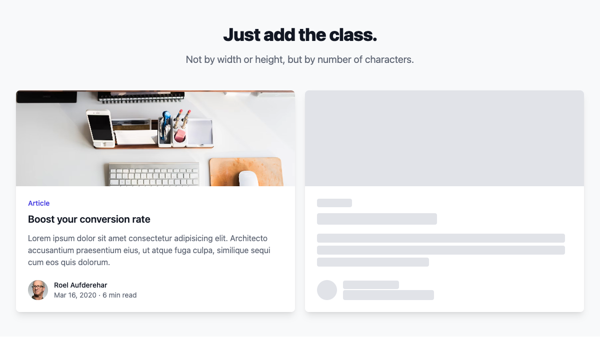
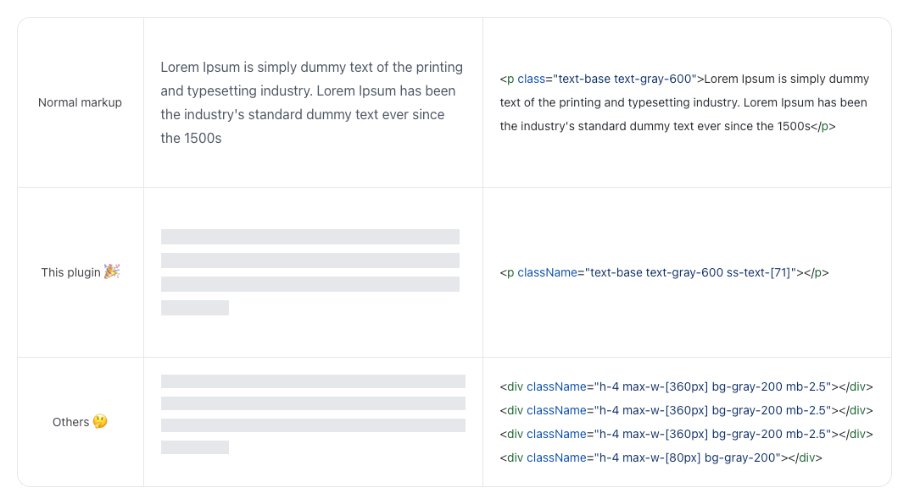

# tailwindcss-skeleton-screen
Just add the class. Not by width or height, but by number of characters.



## Concept

`As close as possible to normal markup`

Skeleton display is performed only when there are no children.  
Just add the class of `ss-text-[n]`.

```jsx
{/* Skeleton displayed only if empty */}
<p className="text-base text-gray-600 ss-text-[71]">{text}</p>
```


### Differences from Others



[PR for checking diff](https://github.com/t4y3/tailwindcss-skeleton-screen/pull/2/files)

### Number of characters, not Height and width
```html
<!-- ❌ -->
<div class="h-4 w-full bg-gray-200"></div>
```

```html
<-- 😍 -->
<p class="ss-text-[24]"></p>
```

### Wrapping of long sentences is also supported
```html
<!-- ❌ -->
<div class="h-4 max-w-[360px] bg-gray-200 mb-2.5"></div>
<div class="h-4 max-w-[360px] bg-gray-200 mb-2.5"></div>
<div class="h-4 max-w-[360px] bg-gray-200 mb-2.5"></div>
<div class="h-4 max-w-[80px] bg-gray-200"></div>
```

```html
<-- 😍 -->
<p class="text-base text-gray-600 ss-text-[71]"></p>
```

## Installation (Tailwind CSS v4)
Install from npm:

```bash
npm install -D tailwindcss-skeleton-screen
```

Add it to your Tailwind entry CSS (v4 style).

Import the package CSS (recommended)
```css
/* tailwind.css (your entry processed by Tailwind v4) */
@import "tailwindcss-skeleton-screen";
```

No tailwind.config.js setup is required for v4.

## Basic usage (v4)
- Specify only the number of characters; height follows `font-size` and `line-height`.

```html
<!-- Shows only when element is empty -->
<p class="text-base text-gray-600 ss-text-[71]"></p>
```

Multiline example (per-line counts by slash):
```html
<p class="ss-text-[24/24/12]"></p>
```

Single-line truncation:
```html
<p class="truncate ss-text-[40]"></p>
```

Utilities

| class            | description |
|------------------|-------------|
| `ss-object`      | Block skeleton with background color |
| `ss-text-[n]`    | Text skeleton for `n` characters |
| `ss-text-[a/b]`  | Per-line characters by slash (multiline) |

Notes
- Skeletons render only when the element is `:empty`.
- Combine with any text utilities; skeleton follows typography.

## Customize (v4 `@theme`)
This package exposes CSS custom properties via Tailwind v4 `@theme`:

```css
@theme {
  --skeleton-color: #e5e7eb; /* default */
  --skeleton-radius: .375rem; /* default (≈6px) */
}
```

Override globally:
```css
@theme {
  --skeleton-color: #f3f4f6;
  --skeleton-radius: .5rem;
}
```

Or locally per scope:
```css
.card { /* affects descendants */
  --skeleton-color: #e2e8f0;
  --skeleton-radius: .25rem;
}
```

## How it works (v4)
- The CSS entry uses `@plugin` to load the package plugin and defines `@theme` tokens.
- The plugin generates placeholder content using full‑width spaces and assigns it to `--tw-content` only when the element is `:empty`.
- The CSS applies background and radius to the pseudo element so your normal markup stays intact.

## Migration from v3
- v3 `tailwind.config.js` plugin registration is no longer needed.
- Use the v4 CSS directives (`@import` or `@plugin`) as shown above.
- Theme options moved to CSS custom properties (`@theme`).
